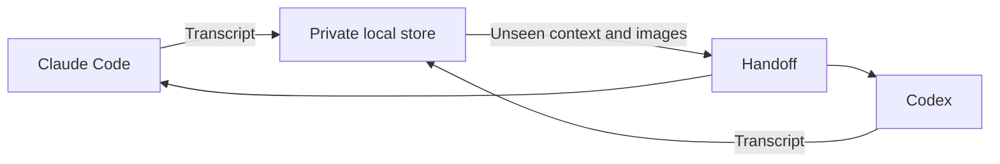

# Agent Context Bridge

Continue a coding task across Claude Code and Codex with shared conversation history.

<br>
<br>

## 1. How it works



The bridge imports supported messages and tool results, then sends unseen context to the selected agent. For long histories, it includes a recent excerpt and a path to the complete handoff file.

## 2. Install

Requires Node.js 24 or later and signed-in Claude Code and Codex installations.

```sh
git clone https://github.com/Choi-JY1107/agent-context-bridge.git
cd agent-context-bridge
npm install
```

## 3. Use

From the project you want to work on, run:

```sh
node <bridge>/src/cli.ts run <private-store> task-1 auto "Inspect the failing test"
node <bridge>/src/cli.ts run <private-store> task-1 codex "Continue the fix"
node <bridge>/src/cli.ts run <private-store> task-1 claude "Review the result"
```

Replace `<bridge>` and `<private-store>` with absolute paths. Use the same store, session name, and working directory for each turn. `auto` tries Claude first and switches to Codex on a usage limit before tool execution.

The private store contains unredacted history and images. Keep it outside public repositories. Up to five supported images are attached per handoff.

Failed runs keep their handoff pending. Check the agent's session before retrying, since it may have already started work. Hidden reasoning and some provider-specific records cannot be transferred.

For manual handoffs, run the CLI without arguments to see `import`, `prepare`, and `ack` usage. Check the import report for unsupported record types.

## 4. Development

```sh
npm test
npm run check
```

[MIT license](LICENSE)
